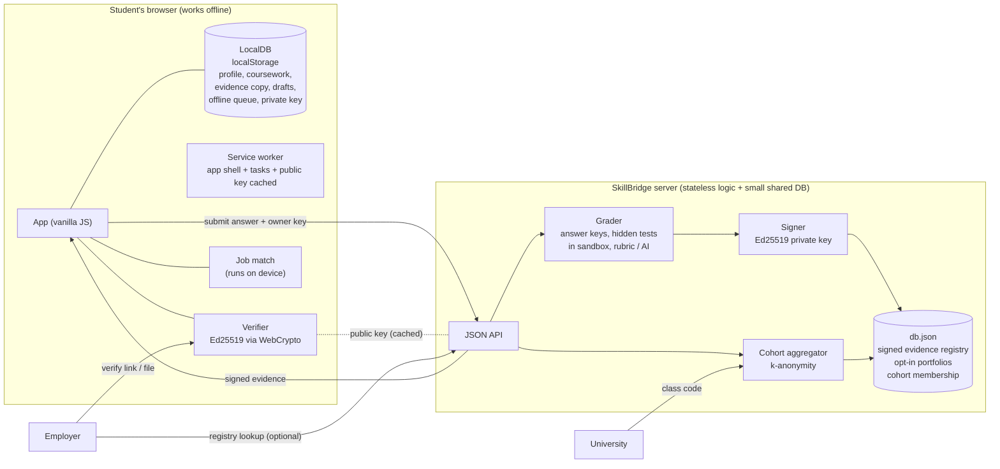

# Architecture

SkillBridge is deliberately small: **zero npm dependencies**, about 95 KB of front end, and a single Node process. That is a feature: it runs on a cheap server, a laptop, or a school lab machine, and anyone can read all of it.

## Two databases, one job each

| | LocalDB (browser) | Server DB (`lib/db.js`) |
|---|---|---|
| Holds | profile, coursework, evidence copy, drafts, queue, cache, private key | signed evidence registry, opt-in portfolios, cohort membership |
| Never holds | | names (except inside signed evidence), emails, coursework, drafts, the private key itself (only its SHA-256) |
| Why | personal data stays on the device; works offline | sharing and verification must work for people who are not the student |

A person is linked to their server records by a random key generated in their browser. The server stores only its hash. The key travels in the student's backup file, so restoring a backup restores ownership.

## Trust model: who can do what

- **Only the server** can create valid evidence (it holds the Ed25519 private key).
- **Anyone** can verify evidence with the published public key (`/.well-known/skillbridge-keys.json`), in their browser, offline. The signature covers every field, including the student's name, score, rubric, submission hash and key id.
- **Key rotation:** retired public keys stay in `data/retired-keys/` and keep being published, so old evidence stays verifiable.
- **Not proven:** who did the work, or that it was unaided (see Limitations in the README).

## Request flow: earning evidence

1. Student writes an answer. Drafts autosave to LocalDB. Offline? The answer waits in the queue.
2. `POST /api/submit` with `x-owner-key`. The server grades (mcq/scenario by key, code by hidden tests in a worker + `vm`, written by AI or rubric), and on a pass signs and stores a record.
3. The browser stores its own copy in LocalDB (best score per task).
4. Employer opens `/verify/<id>`: the page checks the signature **locally** with the public key and asks the registry. Or checks a portfolio file fully offline.

## Privacy-by-design choices

- Coursework, drafts and job ads never leave the device (job matching is local).
- Class dashboards need a minimum group size (default 5), show only aggregates, round percentages to 5, and never return names or identifiers.
- One key cannot read or delete another person's records. Erasing yourself removes evidence, portfolio and class membership.
- Strict CSP, no inline scripts, all user text via `textContent`, the practice-test worker has a policy that forbids every network call.

## Low-bandwidth design

~95 KB of app code (about 28 KB gzipped), no frameworks or CDNs, ETag revalidation (a 304 costs a few hundred bytes), service worker caching, local sample tests for instant feedback, offline queue that grades on reconnect.

## Testing

`node --test` runs 57 tests: AI task generation (validation, shuffled answers, reference-solution check, privacy, daily cap, AI-down behaviour), signing and tamper detection, offline verification with only the public key, sandbox escapes and endless loops, grading for all four task types, answer-position balance, LocalDB (quota, blocked storage, backup/restore), owner isolation, persistence across restarts, cohort privacy rules, job-match scoring, ETags, and the service worker in a simulated environment. `npm run smoke` walks the student, employer and university paths on a real server.
